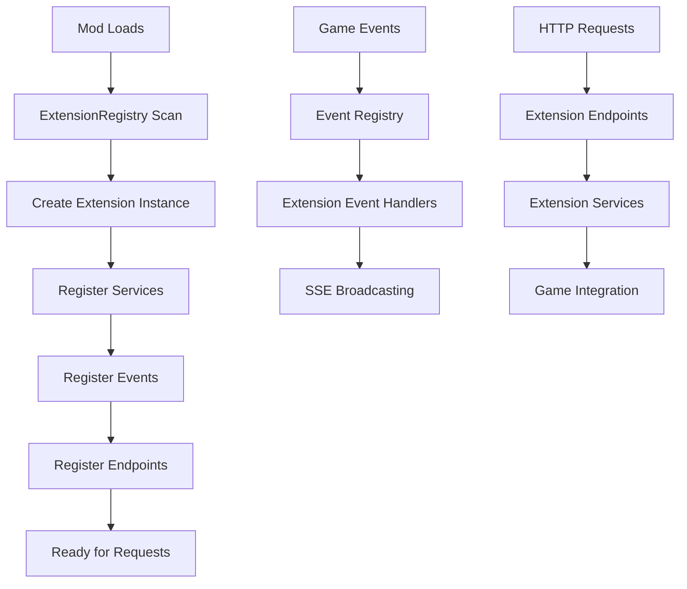

# Creating Extensions

This guide covers how to create RIMAPI extensions to add custom functionality, endpoints, and events to the API. Extensions allow other mods to seamlessly integrate with RIMAPI without modifying the core system.

## Migrating to RIMAPI 1.12.0

!!! warning "Breaking change for extension mods on RimWorld 1.5, 1.6 and 1.7"
    Rebuild extensions against RIMAPI 1.12.0. `IExtensionRouter` callbacks and controller methods now accept `RIMAPI.Http.RimApiContext` instead of `System.Net.HttpListenerContext`. This also changes request and response helper signatures.

1. Add `using RIMAPI.Http;` and change handler parameters to `RimApiContext`.
2. Replace `Request.InputStream` reads with `await context.Request.ReadBodyBytesAsync()`. Decode bytes with `context.Request.ContentEncoding` if needed, or use `await context.Request.ReadBodyAsync<MyDto>()` for JSON.
3. Keep using `Request.QueryString`, `Request.Headers`, `Response.StatusCode` and RIMAPI's response helpers. For raw responses, set `Response.ContentType` and call `await context.Response.SendAsync(bytes)`; this sends and completes the response. For streaming, set `Response.SendChunked = true`, await `WriteChunkAsync(bytes)` for each chunk, and call `Close()` when finished.
4. Build against the matching RIMAPI assembly: `1.5/Assemblies` or `1.6/Assemblies` for .NET Framework 4.7.2, `1.7/Assemblies` for .NET 10. The context API is shared across all three builds.

Do not cast the context to a transport-specific type. RimWorld 1.5/1.6 use HttpListener, while 1.7 uses Watson. HTTP clients continue to use the existing URLs and JSON formats.

## Extension Architecture Overview

Extensions are discovered automatically by RIMAPI and integrated into the API lifecycle:



## Basic Extension Structure

### Core Interface

All extensions must implement `IRimApiExtension`:

```csharp
    public interface IRimApiExtension
    {
        string ExtensionId { get; }
        string ExtensionName { get; }
        string Version { get; }
        
        void RegisterServices(IServiceCollection services);
        void RegisterEvents(IEventRegistry eventRegistry);
        void RegisterEndpoints(IExtensionRouter router);
    }
```

### Minimal Extension Example

```csharp
using System.Threading.Tasks;
using RIMAPI.Core;
using RIMAPI.Http;

public sealed class ExampleExtension : IRimApiExtension
{
    public string ExtensionId => "example";
    public string ExtensionName => "Example API";
    public string Version => "1.0.0";

    public void RegisterServices(IServiceCollection services) { }
    public void RegisterEvents(IEventRegistry events) { }

    public void RegisterEndpoints(IExtensionRouter router)
    {
        router.Get("/ping", Ping);
    }

    private static async Task Ping(RimApiContext context)
    {
        await ResponseBuilder.SendSuccess(context.Response, new { message = "pong" });
    }
}
```

This endpoint is available at `GET /api/v1/example/ping`.

## Extension Discovery

RIMAPI automatically discovers extensions by scanning all loaded assemblies for types implementing `IRimApiExtension`. The discovery process:

- Runs automatically when RIMAPI initializes
- Scans all loaded RimWorld mod assemblies
- Creates instances of found extensions
- Isolates errors - one broken extension won't affect others
- Logs all discovered extensions for debugging

## Service Registration

### Dependency Injection in Extensions

Extensions can register their own services using RIMAPI's DI container:

```csharp
    public void RegisterServices(IServiceCollection services)
    {
        // Singleton - one instance for entire application
        services.AddSingleton<IMyConfigService, MyConfigService>();
        
        // Transient - new instance for each resolution
        services.AddTransient<IMyExampleController, IMyExampleController>();
    }
```

### Service Lifetime Guidelines

| Lifetime | Use Case | Example |
| --- | --- | --- |
| **Singleton** | Configuration, shared state, event publishers | `MyConfigService`, `EventAggregator` |
| **Transient** | Business logic, stateless services, request handlers | `DataProcessor`, `ValidationService` |

### Accessing RIMAPI Core Services

Extensions can consume core RIMAPI services through dependency injection:

```csharp
    public class MyService : IMyService
    {
        private readonly ISseService _sseService;
        private readonly IGameStateService _gameState;

        public MyService(ISseService sseService, IGameStateService gameState)
        {
            _sseService = sseService;
            _gameState = gameState;
        }

        public void DoSomething()
        {
            // Use core RIMAPI services
            var gameMode = _gameState.GetGameMode();
            _sseService.PublishEvent("my-extension.action-completed", new { result = "success" });
        }
    }
```

## Event System Integration

### Registering Custom Events

Extensions can define and publish their own SSE events:

```csharp
    public void RegisterEvents(IEventRegistry eventRegistry)
    {
        // Register custom events
        eventRegistry.RegisterEvent("my-extension.item-crafted");
        eventRegistry.RegisterEvent("my-extension.quest-completed");
        eventRegistry.RegisterEvent("my-extension.error-occurred");
    }
```

### Publishing Events

Use the `IEventPublisher` to broadcast events to SSE clients:

```csharp
    public class MyCraftingService
    {
        private readonly IEventPublisher _eventPublisher;

        public MyCraftingService(IEventPublisher eventPublisher)
        {
            _eventPublisher = eventPublisher;
        }

        public void OnItemCrafted(Thing item, Pawn crafter)
        {
            _eventPublisher.Publish("my-extension.item-crafted", new
            {
                itemId = item.ThingID,
                itemName = item.Label,
                crafterName = crafter.Name.ToString(),
                crafterId = crafter.Id.ToString(),
                timestamp = DateTime.UtcNow
            });
        }
    }
```

### Listening to Game Events

Extensions can hook into RimWorld events and publish them as SSE events:

```csharp
    public class MyGameEventService
    {
        private readonly IEventPublisher _eventPublisher;

        public MyGameEventService(IEventPublisher eventPublisher)
        {
            _eventPublisher = eventPublisher;
        }

        public void Initialize()
        {
            // Hook into RimWorld events
            Find.TickManager.TickManagerTick += OnGameTick;
            Find.Storyteller.incidentQueue.IncidentQueueTick += OnIncidentQueued;
        }

        private void OnGameTick()
        {
            // Publish periodic events
            if (Find.TickManager.TicksGame % 60 == 0) // Every 60 ticks
            {
                _eventPublisher.Publish("my-extension.game-tick", new
                {
                    tick = Find.TickManager.TicksGame,
                    time = DateTime.UtcNow
                });
            }
        }
    }
```

## Endpoint Registration

Use `router.Get`, `router.Post`, `router.Put`, `router.Delete` or `router.AddRoute`. Every callback has the signature `Task Handler(RimApiContext context)`.

```csharp
using System.Threading.Tasks;
using RIMAPI.Core;
using RIMAPI.Http;

public sealed class EchoRequest
{
    public string Message { get; set; }
}

public static class EchoEndpoint
{
    public static void Register(IExtensionRouter router)
    {
        router.Post("/echo", Echo);
    }

    private static async Task Echo(RimApiContext context)
    {
        var body = await context.Request.ReadBodyAsync<EchoRequest>();
        if (string.IsNullOrWhiteSpace(body?.Message))
        {
            await context.SendJsonResponse(ApiResult.ValidationFail("message is required"));
            return;
        }

        await ResponseBuilder.SendSuccess(context.Response, new { message = body.Message });
    }
}
```

### Controller-Based Endpoints

For complex APIs, use controller classes with auto-routing:

```csharp
    using System.Net;
    using System.Threading.Tasks;
    using RIMAPI.Core;
    using RIMAPI.Http;

    // Register with router.RegisterController<ItemsController>().
    public class ItemsController
    {
        private readonly IItemsService _itemsService;

        public ItemsController(IItemsService itemsService)
        {
            _itemsService = itemsService;
        }

        [Get("/item")]
        public async Task GetByItemId(RimApiContext context)
        {
            var id = context.Request.QueryString["id"];
            var item = _itemsService.GetItem(id);
            if (item == null)
            {
                await ResponseBuilder.SendError(context.Response, HttpStatusCode.NotFound,
                    $"Item {id} not found");
                return;
            }
                
            await ResponseBuilder.SendSuccess(context.Response, item);
        }
    }
```

### Endpoint Namespacing

All extension endpoints are automatically namespaced to prevent conflicts:

???+ warning
    Your extension registers: `/items`

    Becomes available at: `/api/v1/your-extension-id/items`

    Example URLs:

    **GET** `/api/v1/my-crafting-mod/items`

    **POST** `/api/v1/my-crafting-mod/items`

    **GET** `/api/v1/my-crafting-mod/items?id=123`

## Complete Example: Crafting Extension

### Extension Definition

```csharp
    public class CraftingExtension : IRimApiExtension
    {
        public string ExtensionId => "crafting-mod";
        public string ExtensionName => "Advanced Crafting API";
        public string Version => "1.0.0";

        public void RegisterServices(IServiceCollection services)
        {
            services.AddSingleton<ICraftingService, CraftingService>();
            services.AddSingleton<ICraftingEventService, CraftingEventService>();
            services.AddTransient<IRecipeService, RecipeService>();
        }

        public void RegisterEvents(IEventRegistry eventRegistry)
        {
            eventRegistry.RegisterEvent("crafting.recipe-started");
            eventRegistry.RegisterEvent("crafting.recipe-completed");
            eventRegistry.RegisterEvent("crafting.recipe-failed");
            eventRegistry.RegisterEvent("crafting.materials-low");
        }

        public void RegisterEndpoints(IExtensionRouter router)
        {
            // Manual endpoint registration
            router.RegisterController<CraftingController>();
            
            // Register the controller and its service dependencies in RegisterServices.
        }
    }
```

### Supporting Services

```csharp
    public class CraftingService : ICraftingService
    {
        private readonly IEventPublisher _eventPublisher;
        private readonly IGameStateService _gameState;

        public CraftingService(IEventPublisher eventPublisher, IGameStateService gameState)
        {
            _eventPublisher = eventPublisher;
            _gameState = gameState;
        }

        public bool StartCrafting(string recipeDefName, string colonistId = null)
        {
            try
            {
                // Implementation logic here
                _eventPublisher.Publish("crafting.recipe-started", new
                {
                    recipe = recipeDefName,
                    colonist = colonistId,
                    timestamp = DateTime.UtcNow
                });
                
                return true;
            }
            catch (Exception ex)
            {
                _eventPublisher.Publish("crafting.recipe-failed", new
                {
                    recipe = recipeDefName,
                    error = ex.Message,
                    timestamp = DateTime.UtcNow
                });
                
                return false;
            }
        }
    }
```

## Error Handling and Isolation

### Extension Error Isolation

RIMAPI provides error isolation to prevent one broken extension from affecting others:

- Exceptions in extension initialization are caught and logged
- Failed service registration doesn't affect other extensions
- Endpoint errors return proper HTTP status codes
- Event publishing failures are logged but don't crash the system

### Proper Error Handling in Extensions

```csharp
    public class RobustCraftingService
    {
        public ApiResult<CraftingResult> StartCrafting(string recipeDefName)
        {
            try
            {
                if (string.IsNullOrEmpty(recipeDefName))
                    return ApiResult.BadRequest("Recipe definition name is required");
                    
                var recipeDef = DefDatabase<RecipeDef>.GetNamed(recipeDefName, false);
                if (recipeDef == null)
                    return ApiResult.NotFound($"Recipe {recipeDefName} not found");
                    
                // Business logic here
                return ApiResult.Success(new CraftingResult { Success = true });
            }
            catch (Exception ex)
            {
                LogApi.Error($"Crafting failed for {recipeDefName}: {ex}");
                return ApiResult.Error($"Crafting failed: {ex.Message}");
            }
        }
    }
```

## Testing Your Extension

### Development Testing Checklist

- [x] Extension is discovered and registered by RIMAPI
- [x] Services are properly registered and resolvable
- [x] Events are registered and can be published
- [x] Endpoints respond correctly to HTTP requests
- [x] Error handling works as expected
- [x] No performance impact on the game
- [x] Works alongside other popular mods

### Versioning

```csharp
    public string Version => "1.2.3"; // Major.Minor.Patch

    // Update version when:
    // - Major: Breaking changes to API
    // - Minor: New features, backward compatible
    // - Patch: Bug fixes, no API changes
```

## Next Steps

- Explore [practical extension examples](examples/simple_extension.md)
- Learn about [creating advanced endpoints](creating_endpoints.md)
- Review [extension development best practices](best_practices.md)
- Check the [auto-generated API reference](../api.md) for available core services
